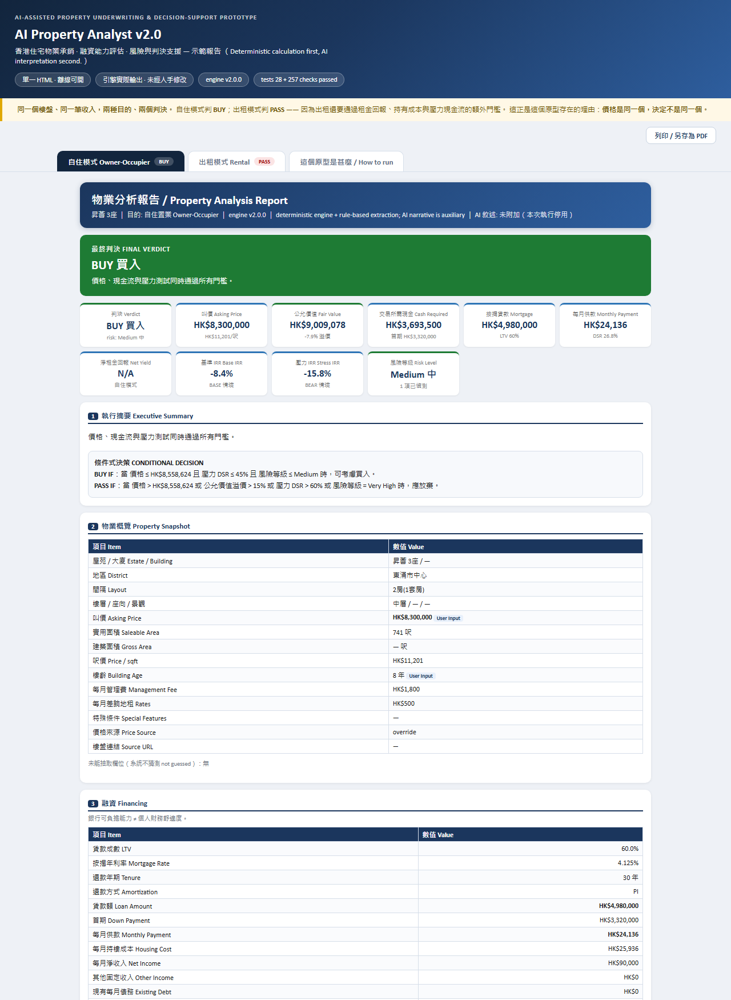
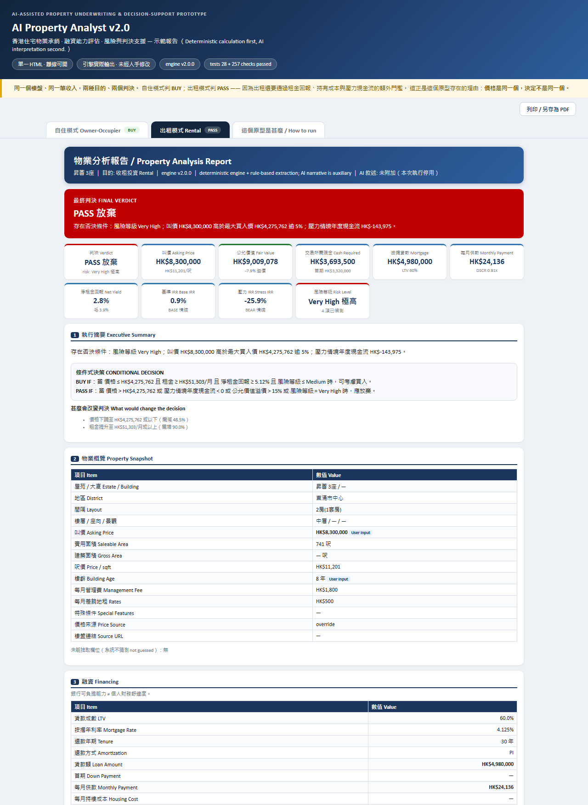

# AI Property Analyst — 香港住宅物業承銷與決策支援原型

**AI-assisted Hong Kong residential property underwriting, financing-capacity assessment and decision support.**

一個規則式（rule-based）的物業分析引擎：輸入一間樓的資料，它用確定的財務模型算出可負擔性、融資能力、
購置現金需求、租金回報、情境與壓力測試，最後給出一個**有條件的判決**（BUY / NEGOTIATE / WATCH / PASS）。

核心原則只有一條：

> **先確定性計算，後 AI 解釋。AI 不是計算器。**

按揭供款、LTV、DSR、首期現金、租金回報、NOI、IRR、公允價值、最大買入價、風險等級、判決 ——
全部由純 Python 計算（`tools/*.py`），**沒有任何一個數字來自語言模型**。LLM 只負責把算好的數字寫成人話，
而且沒有 API key 時整條管線照樣完整跑完，只是不附上敘述。

---

## 同一個樓盤，兩種目的，兩個判決

這是這個原型存在的理由。

| | 自住模式 Owner-Occupier | 出租模式 Rental |
|---|---|---|
| 判決 Verdict | **BUY 買入** | **PASS 放棄** |
| 叫價 Asking Price | HK$8,300,000 | HK$8,300,000 |
| 每月供款 Monthly Payment | HK$24,136 | HK$24,136 |
| DSR | 26.8% | DSCR 0.91x |
| 淨租金回報 Net Yield | — | 2.8% |
| 壓力 IRR Stress IRR | −15.8% | −25.9% |
| 最大買入價 Max Buy Price | HK$8,558,624 | HK$4,275,762 |
| 風險等級 Risk Level | Medium 中 | Very High 極高 |

同一間樓、同一筆收入，價格是同一個，**決定不是同一個** —— 因為出租還要通過租金回報、
持有成本與壓力現金流的額外門檻。單一「上車計算機」永遠看不到這件事。




---

## 報告內容

每份報告有 14 節：執行摘要 · 物業概覽 · 融資 · 購置成本 · 租金經濟 · 估值 ·
情境分析 · 利率壓力測試 · 市場狀態 · 風險分析 · 交易邊界 · 投資判決 · 資料品質與假設 · 資料來源。

幾個刻意的設計：

* **判決是條件式的。** 不是只說「買」或「不買」，而是列出 `BUY IF` / `PASS IF` 的具體門檻，
  以及「甚麼會改變判決」。
* **每個數字都有出處標籤。** `Observed`（公開資料）／`User Input`／`Estimated`／`Assumption`／
  `Research Approximation`／`Model Output` 分開顯示，第 13 節列出硬證據與軟假設的比例。
* **資料不足時不猜。** 估值會回傳 `Insufficient Data` 並說明缺甚麼，
  而不是給一個看起來合理的數字。`資料不足 → AI 猜一個數字` 這條路在結構上被封死。
* **交易邊界引擎。** 除了判決，還會回答「在甚麼條件下這個交易才成立」，
  並印出每一條限制與**哪一條是綁死的那條**，讓結論可以被審計。

---

## 管線

```
物業 URL / 手動輸入
  → 資料抽取（嚴格，抽不到就說抽不到）
  → 確定性承銷計算（按揭、DSR、首期現金、可負擔性）
  → 購置成本模型（AVD 從價印花稅、律師、代理、雜費）
  → 估值引擎（叫價 vs 公允價值）
  → 市場研究（同類成交、租金、按揭、政策）
  → 情境引擎（BEAR / BASE / BULL）
  → 利率壓力測試
  → 市場狀態分類
  → 風險引擎（等級 + Top 3：風險→機制→影響→對策）
  → 交易邊界（「在甚麼條件下」才成立）
  → 投資判決（BUY / NEGOTIATE / WATCH / PASS）
  → DeepSeek 敘述（選填，只做解釋）
  → 14 節 HTML 報告
```

---

## 線上示範

`index.html` 是兩份**真實輸出**的報告（自住 + 出租），由引擎產生、未經人手修改，
單一檔案、離線可開、無任何外部資源。GitHub Pages 直接以此為首頁。

也可以直接下載 `index.html` 用瀏覽器打開，或看 `examples/demo_report.html`。

---

## 本機執行

**需求：Python 3.10 或以上，標準庫即可 —— 不需要 `pip install` 任何套件。** 不需要 Node、資料庫。

```bash
# Windows：雙擊 start_here.cmd
# Mac / Linux：
bash start_here.sh
```

然後開 `http://127.0.0.1:8765/`（登入：帳號任意，密碼 `hkhouse2026` —— 這是本機示範用，
伺服器只綁定 loopback，不對外開放）。

命令列：

```bash
python analyst.py --price 8300000 --area 741 --income 90000 \
    --ltv 60 --rate 4.125 --tenure 30 --purpose owner_occupier \
    --cash 5000000 --available-cash 5000000 --out report.html

python analyst.py --price 8300000 --area 741 --income 90000 --ltv 60 --rate 4.125 \
    --purpose rental --rent 27000 --vacancy 5 --exit-cap 3.5 --hold-years 5 \
    --out report_rental.html
```

驗證引擎：

```bash
python -m tests.test_underwriting    # 28 項 PHASE-3 錨點
python -m tests.test_upgrade         # 257 項 v2.0 驗收檢查
```

所有政策數字（DSR 上限、壓力幅度、LTV 上限、風險門檻、判決門檻）集中在
`tools/config.py` 一個檔案裡，改完重啟即可，不需要動其他程式。

**選填 AI 敘述：** 設定 `DEEPSEEK_API_KEY` 後啟動，報告最後會多一節由 DeepSeek 寫的文字解釋，
明確標示「輔助解釋，不取代任何數字」。沒有 key 也完全不影響其他部分。

---

## 專案結構

```
├─ index.html            GitHub Pages 首頁（兩份示範報告）
├─ analyst_server.py     本機 UI + JSON API（純標準庫）
├─ orchestrator.py       管線組裝：request → 報告 dict
├─ analyst.py            命令列介面
├─ app/index.html        三步驟輸入介面（vanilla JS）
├─ tools/
│  ├─ config.py          所有政策數字：情境、壓力、風險門檻、估值區間、判決門檻
│  ├─ schema.py          輸入正規化與後端驗證
│  ├─ underwriting.py    確定性引擎 + 求解器（損益兩平、上限）
│  ├─ acquisition.py     購置成本模型 + 現金限制下的最高可負擔價
│  ├─ scenarios.py       BEAR/BASE/BULL + 利率壓力
│  ├─ valuation.py       叫價 vs 公允價值
│  ├─ regime.py          市場狀態分類與操作建議
│  ├─ risk.py            風險偵測、等級、Top 3
│  ├─ boundary.py        交易邊界引擎
│  ├─ verdict.py         BUY / NEGOTIATE / WATCH / PASS + 條件式決策
│  ├─ provenance.py      資料出處台帳
│  ├─ research.py        同類成交 / 租金 / 市場 / 按揭 / 政策
│  ├─ official.py        HKMA 住宅按揭統計 + 土地註冊處（Observed 來源）
│  ├─ extract.py         URL → 嚴格樓盤 JSON（不猜）
│  ├─ report.py          14 節獨立 HTML 報告
│  └─ llm.py             選填 DeepSeek 客戶端
├─ tests/                28 + 257 項檢查
└─ docs/                 工程文件與本機執行說明
```

---

## 已知限制（寫在前面）

一個隱藏自己弱點的模型工具，比一個沒有弱點的工具更危險。

1. **銀行批核不是預測目標。** 只提供 `Indicative Financing Capacity`，不預測銀行會不會批。
2. **AVD 從價印花稅的區間與 >HK$100M 稅率**在法例改動後須重新核實；HKMA／土地註冊處數據
   來自公開 API，已標示 `Observed` 並附出處。
3. **IRR 用年度年末現金流**，不是月度。
4. **按揭利率在持有期內固定**，只有壓力測試表會變動利率。
5. **同類成交與租金來源尚未接上即時成交／租務feed。** 沒有提供研究資料集時，
   估值會誠實地回傳 `Insufficient Data`，而不是編一個數字。
6. **模型輸出取決於輸入與已標示的假設。** 這不是投資、稅務或按揭建議。

---

## 技術筆記

* 純標準庫：`http.server`、`urllib`、`json`、`re`。沒有框架、沒有 build step、沒有第三方依賴。
* 前後端雙重驗證：前端 `FIELD_SPECS` 做即時回饋，後端 `tools/schema.py` 從不信任前端。
* 百分比拒絕被猜測：`LTV = 130` 直接 HTTP 400，不會被悄悄夾成 100。
* 認證是 HTTP Basic（單一共用門），因為它有存取成本考量：每次分析都可能花掉 API 額度，
  所以預設有門。密碼未設定時會**隨機產生並印出一次**，而不是用一個大家都知道預設值。

---

## 授權

MIT — 見 [LICENSE](LICENSE)。
